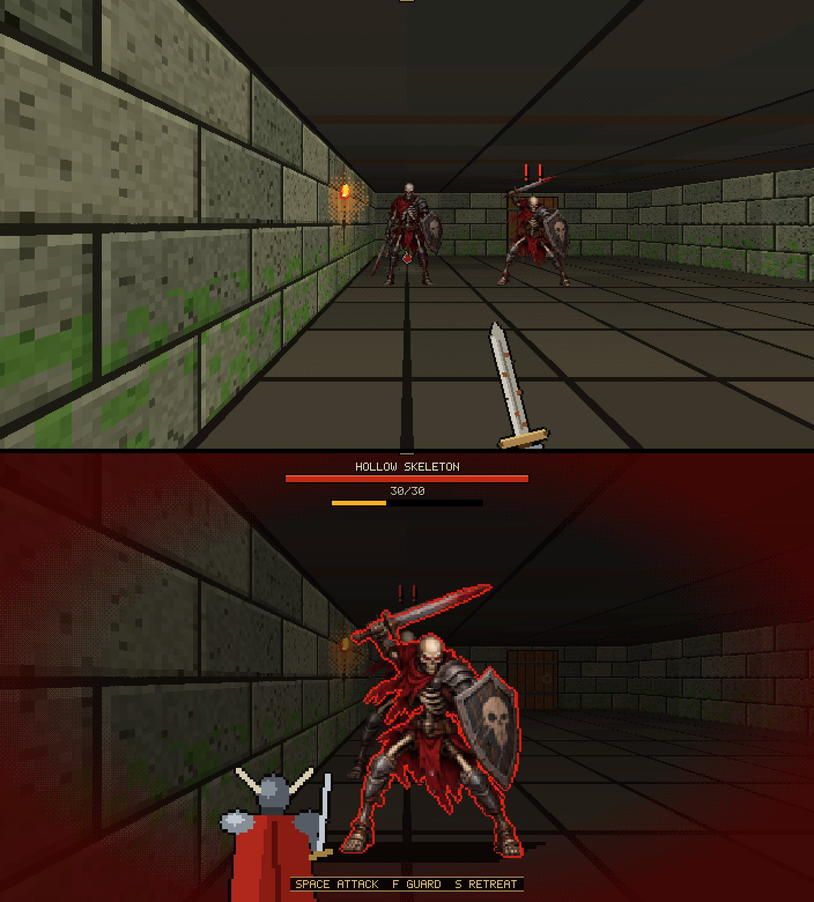
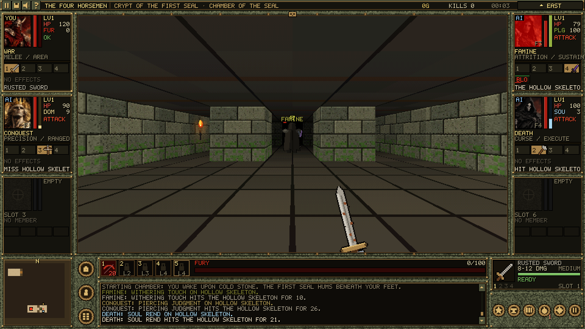

# THE FOUR HORSEMEN: APOCALYPSE — Phase 6 (Polish & Final Optimization)

Dark-fantasy dungeon crawler แนว Wizardry: เดินทีละช่อง มุมมองบุคคลที่หนึ่งแบบ 2D คลาสสิก เล่นได้ **4 Horsemen**
ยังเป็น **2D ล้วน** (HTML5 Canvas 2D + JavaScript ES Modules ไม่มี WebGL หรือ Three.js) และไม่ได้สร้างโปรเจกต์ใหม่ ทุกระบบของ Phase 1–5 ยังอยู่ ชุดทดสอบเดิมทั้งห้าชุดยังผ่านครบ

## ภาพวาดศัตรู (เริ่มจาก Skeleton)



**วิธีเปลี่ยนภาพศัตรูตัวอื่น**

1. วางรูปต้นฉบับที่ `assets/enemies/src/<sprite>_<pose>.webp`
   - ชื่อ sprite ดูได้จาก `sprite:` ใน `enemies.js` / `bosses.js`
   - pose มี idle / windup / attack / hurt ถ้ามีแค่ idle ก็ใช้ได้
2. Bake ใน dev server:
   ```js
   const m = await import('/tools/make-enemy-art.js');
   await m.bakeEnemy('<sprite>');
   ```
   - ตัดพื้นหลังขาว/ลายตาราง (รวมช่องที่ถูกล้อมไว้) ส่วนรูปที่โปร่งใสอยู่แล้วจะคงไว้ตามเดิม
   - ครอปทุกท่าด้วยกรอบเดียวกันโดยยึดลำตัวท่า idle ตัวจึงขนาดเท่ากันและเท้าอยู่ระดับเดียวกันทุกท่า
   - ย่อให้ลำตัวสูง 128 px แล้วบันทึกเป็น `assets/enemies/<sprite>/<pose>.png`
3. เพิ่มชื่อ sprite ใน `src/data/enemyArt.js` (ใส่ `size: 1.3` ได้ถ้าอยากให้ตัวใหญ่กว่าเดิม)

ตอนนี้มีภาพวาดแล้ว: **skeleton**, **abyssbeast** (size 1.5), **captain** (Fallen Knight Captain — Fallen Knight ธรรมดายังเป็น sprite เดิม), **abaddon** (บอสสุดท้าย — มี 3 ท่า ไม่มี hurt)
- ท่าไหนไม่มีไฟล์ต้นฉบับ ตัว bake จะข้ามไป และในเกมจะใช้ภาพ idle แทน (ต้องมี idle เสมอ)
- ถ้ารูปแต่ละท่ามาคนละขนาด (เช่นชุด abyssbeast) ตัว bake จะครอปแต่ละท่าตามตัวเอง ย่อให้สูงเท่าท่า idle แล้ววางเท้าไว้บนเส้นพื้นเดียวกัน

**การแสดงผลในเกม** (`render/EnemyArt.js`)

- ท่าเดินและท่ายืนหายใจสร้างจากภาพ idle (ขยับ 1–2 px)
- `artScale` / `combatMult` ปรับขนาดให้ลำตัวสูงเท่า sprite เดิม ทั้งในฉากเดินและฉาก combat เพราะภาพวาดมีพื้นที่เผื่อให้ดาบที่ยกขึ้นและเลือดที่กระเด็น
- เอฟเฟกต์เดิมใช้กับภาพใหม่ได้ทั้งหมด: เรืองแดงตอนง้าง, กะพริบขาวตอนโดนตี, เงาตามระยะ, ภาพใน bestiary
- ถ้าโหลดไฟล์ไม่ได้ จะใช้ภาพที่โค้ดวาดเหมือนเดิม

**เพลงจากไฟล์** (`src/data/musicFiles.js` + `audio/FileMusic.js`)

1. วางไฟล์ mp3 / ogg / m4a ที่ `assets/music/`
2. ใส่ชื่อไฟล์ใน `MUSIC_FILES` ของ `src/data/musicFiles.js`
   - key คือ state ของเพลง: title, explore, combat, elite, boss, safe, sanctuary, story
   - ใส่เพลงเฉพาะได้ เช่น `'explore:ashen_catacombs'` (ดันเจี้ยนเดียว) และ `'boss:abaddon'` (บอสตัวเดียว) ถ้าไม่มีไฟล์เฉพาะ จะใช้ไฟล์ของ state หลัก
   - ปรับเสียงรายเพลงได้ด้วย `{ file: 'boss.mp3', gain: 0.8 }`

การทำงาน
- เพลงเล่นวนต่อเนื่องและ crossfade ตอนเปลี่ยน state ใช้ปุ่มปรับเสียง MUSIC / MASTER / mute เดิม
- ไฟล์ stream ทีละเพลง และโหลดตอนที่ state นั้นถูกเรียกครั้งแรกเท่านั้น
- elite / boss / story เริ่มเล่นจากต้นเพลงทุกครั้ง เพลงอื่นเล่นต่อจากจุดเดิม (ตั้งได้ใน `MUSIC_FILE_TUNING.restart`)
- stinger (victory / bossDefeat / defeat / chapter) ยังเป็นเสียงสังเคราะห์ เพลงจากไฟล์จะเบาลงชั่วคราวระหว่างที่ stinger เล่น
- state ที่ไม่มีไฟล์ ไฟล์ยังโหลดไม่เสร็จ หรือไฟล์เปิดไม่ได้ จะใช้เพลงสังเคราะห์เดิม
- ตอนนี้มีไฟล์ 7 เพลง: title, explore, elite, boss, safe, sanctuary, story ส่วน combat ยังเป็นเพลงสังเคราะห์
- ใช้เฉพาะเพลงที่มีสิทธิ์ใช้งาน เพราะเกมเผยแพร่สาธารณะบน GitHub Pages

**ผลทดสอบ:** ชุดทดสอบทั้ง 8 ชุดผ่าน (`?test2` ครั้งแรกตกข้อ crossbow ซึ่งเป็น flake ที่รู้จักอยู่แล้ว รันซ้ำผ่าน 52/52)

## Party Combat: Horsemen ทั้ง 4 สู้พร้อมกัน (ผู้เล่นคุม 1, AI คุม 3)



**หลักการ (ใช้ระบบเดิมทั้งหมด ไม่เขียนกติกาใหม่)**

- Horseman แต่ละตัวมีชุดระบบของตัวเอง: CharacterStats, StatCalculator, Equipment, WeaponSystem, ResourceManager, SkillSystem, LegendaryEffects, status, ตัวบนกริด และเป้าหมาย
- `PartySystem.withActor(m, fn)` สลับ `g.hero` / `g.weapons` / `g.player` … ไปเป็นของตัวนั้นชั่วคราว แล้วเรียก `combat.playerAttack()`, `skills.use()`, `combat.enemyStrike()` ตัวเดิม
  - cooldown, ค่าพลัง, hit detection, damage, เกราะศัตรู, status และ mechanic ประจำคลาสจึงเป็นกติกาเดียวกับผู้เล่นทุกอย่าง
- สลับตัวที่ควบคุม = ชี้ `g.*` ไปที่ Horseman อีกตัว กล้องมุมมองบุคคลที่หนึ่ง, skill bar, หน้า equipment และ skills จะตามไปเอง
- กระเป๋าใช้ร่วมกัน แต่ของ 1 ชิ้นใส่ได้คนเดียว

**ควบคุม**

| ปุ่ม | ผล |
|---|---|
| **F1–F4** | ควบคุม Conquest / War / Famine / Death |
| **`** | วนไปตัวที่ยังมีชีวิต |
| คลิก portrait ของเพื่อน | ควบคุมตัวนั้น |

- ช่อง party: ตัวที่คุมอยู่มีกรอบทองและป้าย **YOU** ส่วนเพื่อนมีป้าย **AI** พร้อมสถานะ AI และการกระทำล่าสุด
- SPACE ค้างยังใช้ได้กับตัวที่คุมอยู่ ตัวจับเวลาแยกกัน เพื่อนฟันไม่ทำให้ผู้เล่นช้าลง

**AI เพื่อนร่วมทีม** (`systems/CompanionAI.js`, ค่าอยู่ใน `data/party.js`)

State machine: FOLLOW → SEARCH → APPROACH → ATTACK → DEFEND → RECOVER

- **การเดิน:** ใช้ BFS (`dungeon.nextStep`)
  - ไม่เดินชนผนัง ไม่ยืนทับใคร
  - ถ้าขวางทางผู้เล่น จะสลับที่กันแทนการบล็อก
  - ถ้าตามไม่ทันหรือติดนานเกิน 3 วินาที จะวาร์ปไปหลังผู้นำ
- **การเลือกเป้า:** ให้คะแนนตามคลาส
  - มีโทษเมื่อเพื่อนเล็งเป้าเดียวกันอยู่แล้ว จึงกระจายเป้าเมื่อมีศัตรูหลายตัว
  - ให้ความสำคัญกับศัตรูที่กำลังตีผู้นำก่อน
  - เป้าที่ไปไม่ถึงจะถูกพักไว้ 2.5 วินาที
- **พฤติกรรมตามคลาส:**
  - **Conquest:** ยิงหน้าไม้ หาแนวยิงที่โล่ง ถอยห่างศัตรูระยะประชิด เน้นเป้าที่มี Mark
  - **War:** บุกแนวหน้า กดดันตลอด ใช้ Blood Rush / Cleave
  - **Famine:** Withering, ดูดเลือดเมื่อ HP ต่ำ, Plague / Starvation เมื่อศัตรูหลายตัว
  - **Death:** เน้นเป้าที่ HP ต่ำ, Grave Mark, Soul Rend, Wraith Step เมื่อ HP ต่ำ, Final Silence เป็นท่าปิดเกม
- **OPTIONS:**
  - PARTY: ALL FOUR / SOLO
  - AI STYLE: BALANCED / AGGRESSIVE / CAUTIOUS (ปรับความเร็วตอบสนอง, การกระจายเป้า, ช่วงห่างการใช้สกิล, การ guard และการถอย)
  - COMPANION LOG: KEY EVENTS / EVERY BLOW

**ศัตรู, ความตาย, XP, เซฟ**

- **การเลือกเป้าของศัตรู:** ตีตัวที่อยู่ติดกัน ไม่งั้นไล่ตัวที่ใกล้และมองเห็น ดาเมจลงที่ Horseman ตัวนั้นเท่านั้น
- **poise (เฉพาะโหมด party):** ศัตรูที่เพิ่งสะดุ้งจะไม่สะดุ้งซ้ำภายใน 1.2 วินาที เพื่อไม่ให้ 4 คนรุมจนศัตรูตีกลับไม่ได้เลย ส่วน stagger จากสกิลหรือ parry ยังทำงานตามปกติ
- **log:** ระบุผู้ฆ่า "… falls to DEATH!" และนับ kill ของแต่ละตัว XP แบ่งให้ทั้งปาร์ตี้ จึงเลเวลเท่ากันตลอด
- **ความตาย:**
  - เพื่อนตาย → ที่เหลือสู้ต่อ แล้วฟื้นที่ชั้นถัดไปด้วย 30% HP หรือหายเต็มที่ camp
  - ตัวที่คุมอยู่ตาย → การควบคุมย้ายไปตัวที่ยังมีชีวิต
  - ตายครบ 4 ตัว → game over
- **เซฟ:** บันทึกทั้งปาร์ตี้ (ตัวที่คุม, HP, เลเวล, อุปกรณ์) เซฟเก่าที่ไม่มีข้อมูล party จะได้เพื่อน 3 ตัวที่เลเวลเท่าผู้เล่น พร้อมอาวุธเริ่มต้น

**ทดสอบ**

- `?test8` ผ่าน 22/22 ครอบคลุม acceptance ครบ 10 ข้อ รวมถึง damage ครั้งเดียวต่อ swing, ไม่เดินเข้าผนัง, เป้าที่ไปไม่ถึง, การตาย, ความเร็วที่ 30/144 fps, save/load และ solo
- ชุดเดิม `?test` … `?test7` ยังผ่านครบ แต่รันใน **solo** (`main.js` ตั้ง `forceSolo`) เพราะชุดเหล่านี้วัด baseline ของการเล่นคนเดียว
- bot เล่น Ashen Catacombs จบทั้งด่าน (รวมบอส) ในโหมด party โดยไม่มี error

**ข้อจำกัด / สิ่งที่ยังไม่มีในเกม**

- **ศัตรูบางประเภท:** บอสและศัตรูที่มี ability (Phase 5, เช่นตัวยิงระยะไกล) ยังเล็งเฉพาะตัวที่คุมอยู่ เพราะสคริปต์ของมันใช้ `g.player` เพื่อนตีพวกนี้ได้ตามปกติ
- **กับดักพื้น:** spikes / blight / pit มีผลกับตัวที่คุมอยู่เท่านั้น
- **การฟื้นฟู:** เพื่อนไม่ดื่มยาจากกระเป๋ากลาง HP ฟื้นได้จากสกิลดูดเลือด, level-up, ชั้นใหม่ หรือ camp
- **อุปกรณ์เพื่อน:** เริ่มด้วยอาวุธเริ่มต้นของคลาสเท่านั้น ถ้าจะใส่ของเพิ่มต้องสลับไปคุมตัวนั้นแล้วใส่เอง
- **ไม่มีในเกม จึงใช้สิ่งใกล้เคียงที่มีอยู่:**
  - War ใช้ Rusted Sword (เกมไม่มี greatsword)
  - "ตาชั่ง" ของ Famine เป็นธีมของสกิล ไม่ใช่อาวุธ
  - ระบบ "Hades" ของ Death ยังไม่มี จึงใช้ Soul Harvest / Grave Mark แทน
- **ฉาก combat overlay** (ตอนเผชิญหน้าศัตรูตรงหน้า) แสดงแค่หลังของตัวที่คุมอยู่ การกระทำของเพื่อนดูได้จาก log และช่อง party
- **บาลานซ์:** ยังไม่ได้ปรับใหม่สำหรับ 4 คน ปาร์ตี้แรงกว่าเล่นคนเดียวชัดเจน ถ้าต้องการความท้าทายใช้ CAUTIOUS หรือ SOLO

## UI 16:9 + โจมตีต่อเนื่อง (กด SPACE ค้าง)

**จอภาพ**

- Logical resolution เปลี่ยนจาก 640×480 (4:3) เป็น **960×540 (16:9)**
  - 1920×1080 = 2 เท่าพอดี และ 3840×2160 = 4 เท่า
- `src/core/Display.js` ขยายภาพเอง:
  - ถ้าขนาดหารลงตัวใช้ integer scale
  - ถ้าไม่ลงตัว (เช่น 1280×720 = 1.33 เท่า, 1440p) ใช้วิธี sharp-bilinear คือขยายแบบ nearest เป็นจำนวนเต็มก่อนแล้วค่อยย่อ pixel จึงไม่ยืดไม่เท่ากัน
  - canvas ถูกตั้งขนาดตาม device pixel
- OPTIONS มีตัวเลือก:
  - RESOLUTION: AUTO / 1280×720 … 3840×2160 (จำกัดไม่ให้ใหญ่กว่าหน้าต่าง)
  - SCALING: SHARP FIT / INTEGER (letterbox)
  - DISPLAY: WINDOWED / FULLSCREEN (หรือกด **F11**) ใช้ Fullscreen API ซึ่งเป็นแบบ borderless อยู่แล้ว
- HUD จัดใหม่:
  - viewport โตจาก 384×328 เป็น **704×388**
  - focal 272 คงมุมมองแนวตั้งเดิม
  - วาดผนังด้านข้างเพิ่มเป็น 6 ช่อง
  - อาวุธยึดกับกึ่งกลางจอ
  - ฉาก combat จัดกึ่งกลางใหม่
- ช่อง party สูงขึ้นเป็น 132 px: Horseman ที่เล่นอยู่แสดง status effect (สูงสุด 4 พร้อมแถบเวลา) และชื่ออาวุธในมือ
- แถบบนแสดงชื่อเกม ด่าน ห้อง ทอง kills เวลา และทิศ
- Panel, หน้าเลือกตัวละคร และ camp ยังใช้ grid 640×480 เดิม แต่วางกึ่งกลางจอผ่าน `GameManager._classic()` (ctx.translate + `UIManager.setOrigin`) จึงไม่ต้องเขียนใหม่

**ลบเมนู COMMANDS**

ลบ popup, `LAYOUT.commandMenu`, `g.commands`, `commandIndex` และ `runCommand` ออกแล้ว ทุกคำสั่งยังใช้ได้ผ่านปุ่ม:

| คำสั่ง | ปุ่ม |
|---|---|
| LOOK | L |
| RETREAT / MOVE TO | S / W |
| FIGHT | **G** |
| ATTACK | SPACE |
| DEFEND | F (ค้าง) |
| CAST (สกิลที่พร้อมตัวแรก) | **B** หรือ 1–5 |
| USE | Q |
| SWAP WEAPONS | **V** หรือ Shift+1–4 |
| TURN | **X** |
| RUN AWAY | **Z** |
| SWAP POSITIONS | P |
| CHANGE COLORS | OPTIONS |
| OPEN DOOR | E |
| CANCEL | ESC |

**โจมตีต่อเนื่อง**

- กด SPACE ฟันทันที 1 ครั้ง ถ้ากดค้างจะฟันซ้ำเมื่ออาวุธพร้อมและผ่านไปแล้ว `TUNING.attackRepeat` (0.55 วินาที ปรับได้ใน `data/config.js`)
- อาวุธช้ายังช้าตาม cooldown ของมันเอง
- ไม่มีคิว: ปล่อยปุ่มแล้วหยุดทันที
- ใช้ game time จึงเร็วเท่ากันที่ 20/30/144 fps
- ใช้ `CombatSystem.playerAttack()` เดิมทุกครั้ง คือ hit detection, damage, impact ครั้งเดียวต่อ swing และ "strike at empty air"
- หยุดเมื่อ: ตาย, stun, guard หรือเปิด panel
- จอยก็กดค้างได้ (ปุ่ม A)

**ทดสอบ**

- `?test7` ผ่าน 19/19
- ชุดเดิม: `?test` 29/29, `?test2` 52/52, `?test3` 27/27, `?test4&quick` 27/27, `?test5&quick` 26/26, `?test6&quick` 30/30

**ข้อจำกัด**

- Fullscreen ไม่เข้าในเบราว์เซอร์ที่ถูกควบคุมอัตโนมัติ (preview pane และ Chrome ที่ debugger เกาะอยู่) แม้จะ request ตรงจาก mousedown ก็ตาม เกมจะแจ้ง "Fullscreen is not available here." หลัง 1.5 วินาที ต้องลองกด F11 / OPTIONS ในเบราว์เซอร์ปกติเอง
- หน้าเลือกตัวละคร, camp และ panel มีขอบเข้มด้านข้าง (ขยายพื้นหลัง ไม่ยืดภาพ)
- ภาพตัวอย่าง: `docs/screens/ui16x9_1080.png`

## PHASE 6: รายงานสรุป

### วิธีรัน ทดสอบ และ build
- รันเกม: `npm start` แล้วเปิด <http://localhost:5173> (เกมไม่มีขั้นตอน build: เป็น ES Modules โหลดตรงจาก `src/` ดังนั้นการ "build" คือ copy `index.html` และโฟลเดอร์ `src/` ไปวางบน static server ใดก็ได้; copy `tests/` ด้วยถ้าต้องการรันเทสต์ผ่าน `?testN`)
- ตรวจข้อมูลเนื้อหา: `node tools/validate-content.mjs`
- ชุดทดสอบ (เปิดใน browser แล้วรอจนเสร็จ ผลอยู่ใน console.table และ `window.__pNResults`):
  `?test` (Phase 1), `?test2`, `?test3`, `?test4`, `?test5`, `?test6` (Phase 6, ใส่ `&quick` เพื่อรันเร็ว)
- เสียงจะเริ่มหลังผู้เล่นคลิก/กดปุ่มครั้งแรก (ข้อจำกัดของ browser)

### ผลทดสอบ regression (รันจริงหลังแก้ไขครั้งสุดท้าย)
| ชุด | ผล |
|---|---|
| `?test` Phase 1 | 29/29 PASS |
| `?test2` Phase 2 | 52/52 PASS (ดู known issues: ข้อ crossbow ของ Phase 1 checklist เคยพลาด 1 ครั้งจาก 3 รอบ) |
| `?test3` Phase 3 | 27/27 PASS |
| `?test4` Phase 4 (full) | 27/27 PASS |
| `?test5` Phase 5 (full) | 26/26 PASS |
| `?test6` Phase 6 (full) | 30/30 PASS |
| `node tools/validate-content.mjs` | VALID (0 errors, 0 warnings) |

### สิ่งที่ยืนยันแล้ว (verified) vs ทำบางส่วน (partial)
| ระบบ | สถานะ | หลักฐาน / หมายเหตุ |
|---|---|---|
| **ดนตรีปรับตามสถานการณ์** (title, explore, combat, elite, boss, safe/rest, sanctuary/camp, story, silence + stinger victory / boss defeat / defeat / chapter) | ยืนยันแล้ว | `audio/MusicEngine.js` + `data/music.js`; crossfade แยก bus ต่อ state; combat → explore รอ 3 วินาทีไม่ให้สลับไปมา; `?test6` ตรวจลำดับ state ตามเกมจริง และตรวจใน browser ว่ามีโน้ตถูก schedule และ gain crossfade จริง |
| **เสียงเอฟเฟกต์** (โจมตี/คริ/พลาด, อาวุธแต่ละชนิด, ไอเทม rare→mythic, level-up, quest, chapter, save, UI, ประตู/กับดัก, สถานะ ฯลฯ) | ยืนยันแล้ว | เสียงที่เคยเงียบ 3 ตัว (`buff`, `debuff`, `select`) แก้แล้ว; ทุกชื่อเสียงที่เกมเรียกมีเสียงจริง (เทสต์ "unknown: none"); อาวุธใหม่ 5 แบบมีเสียงของตัวเอง |
| **เอกลักษณ์เสียง Horseman** | ยืนยันแล้ว | Conquest แหลมใส, War ทุ้มหนัก, Famine กลวงผุพัง, Death กระซิบวิญญาณ — เล่นเฉพาะตอนโจมตีโดนจริง (miss ไม่เล่น) + เสียงสกิลของแต่ละคลาสเดิม |
| **ควบคุมเสียง** master / music / effects / ambient / mute / restore defaults | ยืนยันแล้ว | บันทึกถาวร; ปุ่มซ้าย/ขวาปรับเสียงได้ด้วยคีย์บอร์ด; จำกัดการเล่นซ้ำต่อเสียง + จำกัด voice; เสียงพังไม่ทำให้ combat หยุด (เทสต์จำลอง synth throw) |
| **Combat feedback** | ยืนยันแล้ว | ตัวเลขดาเมจ, คริ, MISS, IMMUNE, RESISTED / WEAK!, STAGGERED, ศัตรูกะพริบ + recoil, ขอบจอสีแดงบอกทิศที่โดน (หน้า/ซ้าย/ขวา/หลัง), แขนอาวุธสะดุ้งเมื่อโดน, สีตัวเลขแยกชนิดดาเมจ (กายภาพ/blight/dark) |
| **Hit integrity** | ยืนยันแล้ว | 1 การโจมตี = 1 ครั้งที่ลดเลือด = 1 reaction; ไม่มีดาเมจก่อน hit frame; ศัตรูตายแล้วหยุดโจมตีทันที, loot ไม่ซ้ำ |
| **Animation safety** | ยืนยันแล้ว | watchdog กันศัตรู/บอสค้างใน windup / hurt / cast (เทสต์จำลองค้าง → กู้คืนได้) |
| **Boss presentation** | ยืนยันแล้ว | แถบ cinematic + ชื่อฉายา 2.4 วินาที (ไม่หยุดเกม), phase banner + flash, เพลง boss แยก, stinger ตอนชนะ |
| **Reduced shake / reduced flashing** แยกกัน | ยืนยันแล้ว | ใช้รวมศูนย์ใน `render/Effects.js` (shake ≤ 2px, flash ≤ 0.12 วิ ที่ความเข้ม 15%) |
| **Notifications** | ยืนยันแล้ว | ไอเทม rare/epic/legendary/mythic, quest update/complete, key item, chapter ใหม่, level-up, craft สำเร็จ/ล้มเหลว (รวมวัตถุดิบไม่พอ), กระเป๋าเต็ม, save สำเร็จ/ล้มเหลว — error ค้างจนกว่าจะคลิกปิด, ข้อความซ้ำรวมเป็น xN |
| **HUD** | ยืนยันแล้ว | เพิ่มแถบสถานะ buff/debuff ของผู้เล่นพร้อมเวลาที่เหลือ (ขอบเขียว/แดง); ตำแหน่ง notification ไม่ทับปุ่มหรือเมนูคำสั่ง (ตรวจด้วยภาพจริง) |
| **Tooltip / ช่องไอเทม** | ยืนยันแล้ว | หัวข้อ AFFIXES / UNIQUE EFFECT / MYTHIC EFFECT, เตือนเอฟเฟกต์ที่ใช้ได้เฉพาะคลาส, Legendary/Mythic มีแสงวิ่งรอบกรอบแบบเบา ๆ, ลบบรรทัด SEED (ข้อมูล debug) ออกจาก tooltip |
| **Key rebinding** | ยืนยันแล้ว | หน้า REBIND CONTROLS (18 action); ลูกศรยังใช้ได้เสมอ, Enter/Esc/Tab/ตัวเลขสงวนไว้, ปุ่มที่ชนกันแสดง UNBOUND สีแดง |
| **Save reliability** | ยืนยันแล้ว | ตรวจ snapshot ก่อนเขียน (ข้อมูลเสียไม่ทับ save ดี), backup slot อัตโนมัติ, โหลดพัง → ลอง backup → ไม่สำเร็จจะหยุดที่หน้า title พร้อม error ค้าง (**ไม่รีเซ็ตเกมเงียบ ๆ อีกต่อไป** ซึ่งเป็นบั๊กเดิม), เก็บสำเนา save ที่เสียไว้ 1 ชุด, storage เต็ม/ใช้ไม่ได้รายงานเหตุผล, autosave ระหว่างสู้ถูกเลื่อนไปทำทันทีหลังจบการต่อสู้, ตัวบอก SAVED/SAVE FAILED |
| **12 สถานการณ์ save/load ตามสเปก** | ยืนยันแล้ว | ครบทั้ง 12 ข้อใน `?test6` (ข้อ 12 "ปิดแล้วเปิดใหม่" จำลองด้วย SaveSystem instance ใหม่อ่านจาก localStorage) |
| **Balance** | ยืนยันแล้ว (ด้วย simulation) | ดูตารางด้านล่าง; ค่าปรับทั้งหมดอยู่ใน `data/balance.js` |
| เพลงจากไฟล์จริง | ยืนยันแล้ว | `data/musicFiles.js` + `audio/FileMusic.js`: 7 state ใช้ไฟล์ mp3 ใน `assets/music/` ส่วน state ที่ไม่มีไฟล์ยังเป็นเพลงสังเคราะห์ ตรวจใน browser: crossfade, fallback ของ variant, ไฟล์หาย → synth, ลดเสียงตอน stinger เสียงประกอบ (SFX) ยังเป็นเสียงสังเคราะห์ |
| ปรับขนาดตัวอักษร / UI scaling | ยังไม่ทำ | ความละเอียดตายตัว 640×480 pixel font; เกมขยายทั้งจอตามหน้าต่าง (integer/quarter scale) แต่ไม่มีตัวเลือกขยายเฉพาะตัวอักษร |
| ท่าทางผู้เล่นเฉพาะตอนชนะ/ใช้ไอเทม | บางส่วน | มีแฟลชพอร์เทรต (heal/level/damage) + particle แต่ไม่มี sprite ท่าทางเฉพาะ |

### Main Menu ใหม่ (อัปเดตหลัง Phase 6)
หน้าเมนูหลักทำใหม่ตามภาพคอนเซปต์ (ยังเป็น 2D ล้วน) แยกเป็นชั้นชัดเจน:
1. **ภาพพื้นหลัง** `assets/title/menu_bg.webp` — มาจากภาพคอนเซปต์ `assets/title/concept_src.webp` ซึ่งมีชื่อเกม/ปุ่ม/แถบปุ่มควบคุม **วาดติดมาในภาพ** จึงลบส่วนนั้นออกด้วยเครื่องมือ `tools/clean-title-art.js` (เติมสีจากรอบ ๆ + ลายควัน/เกรน ทำซ้ำได้) แสดงเต็มหน้าต่างแบบ cover ทำให้คมบนจอ 16:9
2. **บรรยากาศ** — canvas ความละเอียดต่ำ (พิกเซลใหญ่แบบ pixel art): ประกายไฟลอยขึ้น, เถ้าตกลง, หมอกเลื่อนช้า ๆ, แสง Blood Moon เต้นเบา ๆ (ตำแหน่งคำนวณตามภาพจริง), parallax ตามเมาส์เล็กน้อย (ปิดเองเมื่อเลือก REDUCED SHAKE หรือระบบตั้ง reduced motion)
3. **UI จริงเป็น HTML/CSS** — ชื่อเกม THE FOUR HORSEMEN / APOCALYPSE / DUNGEONS OF THE END เป็นข้อความแก้ได้ใน `src/ui/TitleScreen.js` (ฟอนต์ Cinzel / Cinzel Decorative จาก Google Fonts, SIL OFL; ออฟไลน์จะใช้ serif ของเครื่องแทน), ปุ่มมีสถานะ normal / hover / focus (คีย์บอร์ด) / pressed / disabled
- ปุ่ม: **NEW GAME** (เลือก Horseman), **CONTINUE** (โหลด save ล่าสุด แสดงชื่อ Horseman + เลเวล, ปิดใช้งานพร้อมข้อความ NO SAVE FOUND เมื่อไม่มี save), **OPTIONS** (แผงตั้งค่าเดิม เปิดทับภาพที่หรี่ลง), **QUIT GAME** แสดงเฉพาะเมื่อแพลตฟอร์มรองรับ (`window.__platform.quit` เช่น desktop wrapper) — ในเบราว์เซอร์แท็บปิดตัวเองไม่ได้ จึงไม่แสดงปุ่มที่กดแล้วไม่ทำงาน
- คีย์บอร์ด: ขึ้น/ลง (W/S หรือลูกศร) ข้ามปุ่มที่ปิดใช้งาน, Enter ยืนยัน — ใช้ระบบเมนูเดิมของเกม (`activeMenu` / `menuIndex`)
- เสียง: hover / confirm ผ่าน AudioManager เดิม, เพลงเมนู (state `title`) เริ่มหลังคลิก/กดปุ่มครั้งแรก (มีข้อความบอกถ้าเสียงยังถูกบล็อก)
- แถบปุ่มควบคุมเล็ก ๆ ด้านล่าง สร้างจาก key binding จริง (เปลี่ยนตามการ rebind): MOVE, ATTACK, INTERACT, GUARD, MENU
- ตรวจแล้วที่ 1280×720 (16:9), 1024×768 (4:3), 800×400 และมือถือ 375×812: ชื่อเกมและปุ่มไม่หลุดขอบ ไม่มี scroll แนวนอน
- ข้อจำกัด: บนจอแคบ/แนวตั้ง ส่วนกลางภาพที่ถูกลบตัวหนังสือออก (ควันสีแดง) จะเห็นชัดกว่าบนจอกว้าง

### Portrait ภาพวาดของ Horsemen
- ไฟล์: `assets/portraits/conquest.webp`, `war.webp`, `famine.webp`, `death.webp` (352×416 = 8 เท่าของช่อง 44×52) ครอปจากภาพต้นฉบับใน `assets/portraits/src/` ด้วย `tools/make-portraits.js` (ตำแหน่งครอปแก้ได้ใน `PORTRAIT_CROPS`)
- โหลดตอนเริ่มเกมโดย `src/render/PortraitArt.js`: ย่อแบบคุณภาพสูงเป็น 44×52 (HUD, ค่าย, หน้าอุปกรณ์), 88×104 (หน้าเลือก Horseman) และสร้างเวอร์ชัน "sealed" (มืด + โซ่ + กุญแจ) ให้ช่องพักอัตโนมัติ
- **เปลี่ยนภาพ:** วางไฟล์ใหม่ทับชื่อเดิม (ขนาดไหนก็ได้ ระบบจะครอปตรงกลางให้เป็นสัดส่วน 11:13) ถ้าไฟล์หายหรือเสีย จะกลับไปใช้ภาพที่วาดด้วยโค้ดเดิมอัตโนมัติ

### Balance: สิ่งที่วัดและสิ่งที่เปลี่ยน
วัดด้วย `tests/balance.js` (ใช้ระบบจริงทั้งหมด, RNG แบบ seed เพื่อให้ผลซ้ำได้, เฉลี่ย 3 seed × 60 วินาที, ฮีโร่ boost พร้อมอุปกรณ์ระดับ epic)

| การเปลี่ยนแปลง | เหตุผล (ตัวเลขก่อนแก้) |
|---|---|
| Conquest: ยิงแบบ empowered (×1.6 ตอน Dominion เต็ม) **ใช้ Dominion 35** | เดิมไม่เสียอะไรเลย + marked hit เติม 15 → เต็มตลอด = ×1.6 ถาวร (resource loop); DPS เป้าเดียวสูงกว่าคลาสอื่น 1.6–2.6 เท่า |
| Conquest: marked hit เติม Dominion 15 → **12** | ลดความถี่ของ empowered shot |
| Death: เพิ่ม **Soul Harvest** — ได้ 1 Soul เมื่อเลือดศัตรูผ่านเกณฑ์ (ปกติ 50%, elite 60/30%, บอส 80/60/40/20%) ครั้งเดียวต่อเกณฑ์ | Souls ได้จากการฆ่าเท่านั้น → สู้บอสเป้าเดียวแทบไม่มี resource (Soul ใช้ไป 3 จาก 30 วินาที, DPS ต่ำสุด) |
| Famine: Black Plague 3 (+1.5/stack) → **5 (+2.5/stack)** | Famine ต่ำสุดทั้งเป้าเดียวและกลุ่ม; DoT ซึ่งเป็นเอกลักษณ์ให้ดาเมจแค่ ~28 DPS |
| ค่าปรับคลาสทั้งหมดย้ายไป `data/balance.js` | สเปกขอให้ปรับผ่าน data ไม่ฮาร์ดโค้ดกระจาย |

ผลหลังแก้ (DPS, L25, เฉลี่ย 3 seed):

| | War | Conquest | Famine | Death | ต่าง (สูงสุด/ต่ำสุด) |
|---|---|---|---|---|---|
| เป้าเดียว | 276 | 313 | 242 | 240 | 1.30× (ก่อนแก้ ~1.6–2.6×) |
| 3 เป้า | **525** (เด่นสุด = เอกลักษณ์ War) | 299 | 271 | 392 | |

ระดับอื่น (ค่าเฉลี่ย 3 รอบ): L8 เป้าเดียว 120/164/131/110 (1.49×), L45 เป้าเดียว 526/626/442/503 (1.42×), L45 3 เป้า War 1178 นำ

ตรวจ exploit:
- ไม่มีคลาสไหนฟื้นเลือดได้มากกว่าที่โดน (Famine ฟื้น ~17–22% ของที่โดน, คลาสอื่น 0% ในสถานการณ์ไม่มีการฆ่า)
- spam stagger ใส่บอสต่อเนื่อง → บอสถูกล็อกได้สูงสุด 20% ของเวลา (มี stun immunity + rank control)
- CDR ไม่เกิน 20%, คริต่อครั้งไม่เกิน 75%, multiplier ของ unique ไม่เกิน +50% (Phase 5)

**เมทริกซ์แคมเปญ** (บอทเล่นจริง ทุก Horseman × ทุกบท ที่เลเวลแนะนำ): 24/24 เคลียร์ ไม่มีตาย, เวลาบอส 19–58 วินาที
> ข้อจำกัด: ฮีโร่ถูก boost พร้อมอุปกรณ์ epic จึงพิสูจน์ว่า "ทุกคลาสจบได้" แต่ไม่ได้พิสูจน์ความยากที่พอดีสำหรับผู้เล่นที่เล่นต่อเนื่องโดยไม่ boost

### Asset ที่ยังขาด / placeholder
- **เพลงทั้งหมด** (9 state + 4 stinger) — สังเคราะห์ตอนรันจาก `data/music.js` (ต้นฉบับ, ชั่วคราว)
- **เสียงทั้งหมด** — สังเคราะห์ (Web Audio) ไม่มีไฟล์
- สไปรต์ทั้งหมดยังเป็น procedural pixel art (ดู Phase 5 asset manifest); อาวุธ 5 แบบใหม่ยังใช้ภาพมือถืออาวุธเดิม
- ไม่มี sprite ท่าทางผู้เล่นตอนชนะ / ใช้ยา / ตาย (ใช้ effect บนพอร์เทรตและจอแทน)

### Known issues
- เทสต์ Phase 2 ข้อ "Crossbow hits a distant target" (ส่วนหนึ่งของ Phase 1 checklist ที่รันกับคลาส Famine) **พลาด 1 ครั้งจาก 3 รอบ**: บอทต้องหาศัตรูที่อยู่ในแนว 2–6 ช่องก่อนอัศวินเดินเข้ามาประชิด เป็นความไม่แน่นอนของบอท ไม่ใช่บั๊กการยิง (รอบอื่นผ่าน)
- ผล DPS มีความแปรปรวนระหว่าง seed (เช่น Death 215–289 ที่ L25) จึงต้องดูค่าเฉลี่ย
- Arena ของ Abaddon ยังมีช่องแคบที่หลบไม่ได้ถ้า locust ยืนขวาง (ยกมาจาก Phase 5)
- Notification ตอนเปิด panel ในค่ายจะวาดทับมุมขวาบนของ panel (ตั้งใจให้ error เห็นชัด คลิกปิดได้)

### ไฟล์ใหม่/แก้ใน Phase 6
- ใหม่: `audio/MusicEngine.js`, `data/music.js`, `data/balance.js`, `ui/Notifications.js`, `tests/balance.js`, `tests/phase6.js`
- แก้: AudioManager (bus ambient, cue ใหม่, stats), GameManager (music director, notifications, save indicator, autosave เลื่อนได้, โหลดพังไม่รีเซ็ต, rebinding, reset settings), SaveSystem (validate/backup/quota/quarantine), Input (rebinding), Effects (reduce shake/flash, damage direction), CombatSystem (resist/weak, class accent, feedback counters, sideOf), EnemyAI (watchdog, recoil, stagger feedback), DungeonRenderer (recoil, weapon jolt), HUD (status strip), Panels (options ใหม่, keybinds), ItemTooltip (sections, glint), BossEncounterController (entrance), QuestManager/CraftingSystem (notifications), HorsemanMechanics (อ่านค่าจาก data/balance.js), skills (Black Plague), weapons (เสียงอาวุธใหม่), `tests/phase2.js` (อ่านค่า Conquest จาก balance data), `tests/phase4.js` (บอทหลบไม่ได้แล้วสู้ต่อ — ทำใน Phase 5)
- Save key: `fh5_save_v5` + `fh5_save_v5_backup` (+ `fh5_save_damaged` เก็บสำเนาที่เสีย) — save format ยังเป็น v5 ไม่ต้อง migrate

## PHASE 5: สรุป

### วิธีเล่นส่วนใหม่
1. เริ่มเกมใหม่ → เล่น **Prologue: The First Omen** (Crypt of the First Seal) → ไปที่ **The Last Sanctuary** (ค่ายเดิม)
2. คลิกใบหน้า NPC แถวล่างซ้ายเพื่อคุย (`!` = มีเควสต์ใหม่, `?` = ส่งเควสต์ได้) แล้วกด **J** หรือปุ่ม **JOURNAL** เพื่อเปิดสมุดบันทึก (QUESTS / CODEX / BESTIARY / CHAPTERS)
3. เมื่อทำเควสต์หลักของบทจบ บทถัดไปจะปลดล็อกพร้อมหน้าจอชื่อบท
4. ตรวจข้อมูลเนื้อหา: `node tools/validate-content.mjs`
5. ชุดทดสอบใหม่: <http://localhost:5173/?test5> (เพิ่ม `&quick` เพื่อรันเร็ว) ผลอยู่ใน `window.__p5Results`

### ผลการทดสอบ (รันจริงในเบราว์เซอร์หลังแก้ไขครั้งสุดท้าย)
| ชุด | ผล |
|---|---|
| `?test` (Phase 1) | 29/29 PASS |
| `?test2` (Phase 2) | 52/52 PASS |
| `?test3` (Phase 3) | 27/27 PASS |
| `?test4` (Phase 4, full) | 27/27 PASS |
| `?test5` (Phase 5, full) | 26/26 PASS |
| `node tools/validate-content.mjs` | VALID (0 errors, 0 warnings) |

สิ่งที่ `?test5` ตรวจ: สร้างไอเทมจาก catalog 18,180 ชิ้น (ไม่มี affix ผิดกฎ, ไม่มีกลุ่มซ้ำ, ชื่อสะอาด), กฎความเข้ากันได้ (fire / ranged / two-handed), stat cap, unique effect + tooltip + ICD, ข้อมูลศัตรูครบทุกตัว, ความสามารถศัตรูใน floor จริง (มี windup ทุกครั้ง, summon มีเพดาน, ไม่มี stun chain), dungeon บท V–VI สร้างได้ถูกต้องพร้อม miniboss, boss phase ครบตามลำดับ (Beast 3, Abaddon 4), เควสต์ (prerequisite, event, state, claim ครั้งเดียว, save/load), ending choice, migration v4 → v5, codex จาก tablet และ **บอทเล่นจริงทั้ง 4 Horsemen ตั้งแต่ Prologue ถึงจบ Chapter I แบบมีเควสต์** (Gravekeeper, Grave Warden, ส่ง fragment, ปลดล็อก Chapter II) และฮีโร่ที่ boost เลเวลแล้วเล่นจบ Chapter V และ VI (Cerberus, the Beast, False Prophet, Great Dragon, Abaddon)

### Content inventory (สถานะจริง)
สถานะ: **ครบ** = เล่นได้และมีเทสต์ครอบ, **บางส่วน** = มีข้อมูล/ระบบแต่ยังไม่ครบตามสเปกหรือยังไม่ได้เทสต์แบบเล่นจริง, **ยังไม่ทำ**

| หมวด | จำนวน | สถานะ | หมายเหตุ |
|---|---|---|---|
| Base equipment | 401 (catalog 303 = family × tier, เดิม 98) | ครบ | `data/itemCatalog.js` 8 tiers (rusted…abyssal) มี ilvl window, tags, แหล่งดรอป |
| Generated variations | หลายพันแบบ (เทสต์ 18,180 ชิ้น, 13,496 signature ไม่ซ้ำ) | ครบ | Base + ilvl + rarity + affixes + unique + set |
| Affixes | 60 (ใหม่ 30) | ครบ | มี `requires` (tag / ranged / melee / twoHanded) |
| Curated legendaries | 21 | ครบ | effect แบบ data-driven ผ่าน dispatcher กลาง มี ICD |
| Mythics | 8 (ใหม่ 4) | ครบ | |
| Sets | 8 | บางส่วน | 4 ชุดประจำ Horseman + 4 ชุดใช้ร่วม (สเปกพูดถึง "one per Horseman" — ชุดใช้ร่วมไม่ผูกคลาส) |
| Weapon behaviours ใหม่ | 5 (greatsword, hammer, spear reach 2, scythe cleave, bow) | บางส่วน | กลไกทำงาน แต่ใช้สไปรต์มือถืออาวุธเดิม (placeholder) |
| Enemies | 21 (ใหม่ 9 รวม illusion) | ครบ | ทุกตัวมี category, lore, loot, resist/statusRules ตามบทบาท |
| Variants | 9 (Armored, Frenzied, Vampiric, Blighted, Cursed, Spectral, Soulbound, Ancient, Abyssal) | ครบ | data-driven, มี minLevel, ไม่ใช้กับบอส |
| AI behaviours | ranged, charge, nova, empower (support), summon (capped), gaze | บางส่วน | "guardian" ยังใช้พฤติกรรม melee เดิม ยังไม่มี component แยก |
| Bosses | 10: miniboss 4 (Gravekeeper, Cerberus, False Prophet, Great Dragon), chapter boss 5, endgame 1 (Abaddon 4 phases) | ครบ | ไม่มีบอสตัวไหน immune ต่อ class status เกิน 1/8 |
| Mythological roster | Abaddon, Great Dragon, the Beast, False Prophet, Nephilim, Cerberus, Chimera, Gorgon, Lich/Revenant, Abyssal Beast/Locust | ครบ | ชื่อจากคัมภีร์/ตำนาน แต่พฤติกรรมและ lore เป็นเรื่องแต่งใหม่ (ระบุไว้ใน codex) |
| Dungeons | 7 (ใหม่: Abyssal Gate, Last Revelation) | ครบ | |
| Campaign | Prologue + บท I–VI (จำนวนบทปรับได้ใน `CHAPTERS`) | บางส่วน | **Prologue และ Chapter I เล่นจริงครบแบบมีเควสต์**; บท II–VI มีเควสต์/บทสนทนา/รางวัลครบในข้อมูลและผ่าน unit test แต่บอทยังไม่ได้เล่นแบบไล่เควสต์ (เล่นเฉพาะ dungeon) |
| Quests | 17 (main 7, side 10) | บางส่วน | objective 12 ชนิด: talk, boss, complete, keyItem, kill, collect, craft, secret, puzzle, reach, lore, deliver |
| NPCs | 5 (Elder Maren, Brother Ansel, Ysolde, the Ferryman, the Blind Seer) | ครบ | บทพูดตามบท + บทพูดเฉพาะแต่ละ Horseman |
| Lore / codex | 35 entries | ครบ | ค้นพบจาก tablet ใน dungeon, จากการฆ่าบอสที่เกี่ยวข้อง หรือจากรางวัลเควสต์ |
| Ending | 2 ทางเลือก (Seal / Claim) บันทึกใน save | ครบ | |
| Journal UI | QUESTS / CODEX / BESTIARY / CHAPTERS | ครบ | |
| Content validator | `src/data/registry.js` + `tools/validate-content.mjs` | ครบ | ทดสอบแล้วว่าจับ reference ผิดได้จริง |
| Save v5 + migration report | | ครบ | v4 ไม่ถูกเขียนทับ; เป้าหมายที่ทำไปแล้วใน v4 นับให้เควสต์ |
| เสียงประกอบเฉพาะมอนสเตอร์ใหม่ | | ยังไม่ทำ | ใช้เสียงสังเคราะห์เดิมซ้ำ |

### Asset manifest
ทุก asset ยังเป็น **procedural placeholder** (วาดด้วยโค้ดตอนเริ่มเกม ไม่มีไฟล์ภาพหรือเสียงภายนอก):
- `render/SpritesPhase5.js` — สไปรต์ศัตรู/บอสใหม่ 14 แบบ, portrait NPC 5 แบบ (48×48), ไอคอนไอเทม 16 แบบ — **placeholder**
- อาวุธใหม่ (greatsword, hammer, spear, scythe, bow) ใช้สไปรต์มือถืออาวุธเดิมผ่าน `fp` mapping — **placeholder**
- illusion ของ False Prophet ใช้สไปรต์ prophet ตัวเดียวกัน — **placeholder**
- เสียง: ใช้ AudioManager แบบสังเคราะห์เดิม (`bossCast`, `curse`, `summon` ฯลฯ) ไม่มีเสียงใหม่ — **placeholder**

### Known issues
- สมดุลเป็นค่าประมาณจากบอท: เทสต์ Chapter V–VI ใช้ฮีโร่ boost เลเวลพร้อมอุปกรณ์ระดับ epic ไม่ใช่การเล่นต่อเนื่องจากบทก่อน
- ใน arena ของ Abaddon มีเสาที่ทำให้เกิดช่องแคบ ถ้า locust ยืนขวางด้านหลัง ผู้เล่นอาจหลบ telegraph ไม่ได้ (ยังโจมตีบอสหรือ locust ออกได้) บอททดสอบเคยติดจุดนี้และแก้ที่บอทแล้ว ตัวเกมยังไม่ได้แก้
- เควสต์ข้างแบบ kill อาจต้องเล่น dungeon ซ้ำ (บอทได้ skeleton 6–8/8 ต่อรอบ) ไม่พลาดถาวร
- บท II–VI เล่นแบบไล่เควสต์ด้วยมือได้ แต่ยังไม่มีบอทเล่นครอบแบบเดียวกับ Chapter I
- Fire Breath ของ Chimera ใช้ damage kind "dark" ตอนคำนวณ resist (ยังไม่มี fire resistance แยก)
- ชื่อไอเทมที่มีทั้ง prefix และ tier ยาวได้ถึง ~40 ตัวอักษร เช่น "Arcane Warforged Band of Precision" (ช่อง tooltip รองรับได้)

### Phase 6 roadmap
1. บอทเล่นบท II–VI แบบไล่เควสต์ต่อเนื่องด้วยฮีโร่ตัวเดียว (ไม่ boost) และปรับสมดุลตามผล
2. แทน placeholder ด้วย pixel art จริงของมอนสเตอร์/อาวุธ/NPC และเสียงเฉพาะของบอส
3. แยก fire / blight / dark resistance และ AI "guardian" เป็น component จริง
4. ปรับ arena ของ Abaddon ไม่ให้มีช่องแคบที่หลบไม่ได้ และเพิ่มเทสต์ "ต้องมีช่องหลบเสมอ" ให้ทุก arena
5. เพิ่มทางเลือกในเควสต์ข้างที่ส่งผลต่อบทพูด NPC (save track ได้แล้ว)
6. New Game+ / ความยากหลังจบเกม

### ไฟล์ที่เพิ่ม/แก้หลักใน Phase 5
- ใหม่: `data/itemCatalog.js`, `data/uniqueItems.js`, `data/campaign.js` (chapters, NPCs, quests, key items, endings), `data/lore.js`, `data/registry.js`, `data/dungeons/abyssal_gate.js`, `data/dungeons/last_revelation.js`, `systems/EnemyAbilities.js`, `systems/QuestManager.js`, `render/SpritesPhase5.js`, `ui/JournalUI.js`, `tools/validate-content.mjs`, `tests/phase5.js`
- แก้: affixes, weapons, formulas, items, sets, enemies, bosses, difficulty, dungeonLoot, materials, recipes, ItemGenerator, LootSystem, StatCalculator, SkillSystem, StatusEffectManager, LegendaryEffects, CombatSystem, EnemyAI, BossEncounterController, DungeonGenerator, DungeonDirector, DungeonProgress, SaveSystem/SaveMigration (v5), GameManager, CampUI, ItemTooltip, `tests/phase4.js` (เปิดให้ phase5 ใช้บอทร่วม + แก้บอทติดตอนหลบไม่ได้)
- Save key ใหม่: `fh5_save_v5` (อ่าน v4/v3/v2/v1 แล้ว migrate ในหน่วยความจำ ไม่เขียนทับของเดิม)

## PHASE 4: สรุป

### วิธีเล่น
1. `npm start` แล้วเปิด <http://localhost:5173>
2. START GAME → เลือก Horseman → เล่น **Prologue** (Crypt of the First Seal ของ Phase 1–3)
3. จบ Prologue แล้วกด **TO THE CAMP** เพื่อไปที่ **The Pale Camp** ซึ่งเป็นศูนย์กลางของเกม ที่นี่ทำได้:
   - เลือกดันเจี้ยนและระดับความยาก
   - ดูเลเวลที่แนะนำ คำเตือนเมื่อเลเวลต่ำเกิน วัตถุดิบที่หาได้ และสถานะบอส
   - คราฟต์ที่ forge
   - จัดการอุปกรณ์
   - รับของจาก stash
4. ปุ่มใหม่:
   - **O**: เปิดหน้าภารกิจ (objectives)
   - **L**: มองหาห้องลับ
   - **ESC → RETURN TO CAMP**: ออกจากดันเจี้ยนกลางทาง รอบที่เล่นค้างไว้จะถูกพักไว้ตามเดิม ไม่สุ่มใหม่
   - **Options → SCREEN EFFECTS: REDUCED**: ลดการสั่นจอและแสงวาบ

### ดันเจี้ยน (ทั้ง 4 แห่งเล่นจบได้จริง แห่งละ 2 ชั้น มีบอส)

| ดันเจี้ยน | เลเวลแนะนำ | ศัตรู | วัตถุดิบเด่น | บอส |
|---|---|---|---|---|
| I Ashen Catacombs (ดันเจี้ยนอ้างอิง) | 1–10 | Hollow Skeleton, Grave Crawler, Fallen Knight | Bone Fragment, Rusted Iron, Grave Dust, Lesser Soul Fragment | Grave Warden: ฟันหนัก, ทุบพื้น (Grave Slam), เรียกโครงกระดูก, บาเรียกระดูก, ปั่นป่วนเมื่อ HP ต่ำ |
| II Red Warfront | 10–20 | Fallen Legionnaire, War Hound, Iron Executioner | Tempered Iron, War Essence, Broken Weapon Core, Crimson Ash | Iron Tyrant: Iron Skin ลดดาเมจจนกว่าเกราะจะแตก (ทุบพื้นจบ, parry หรือ Armor Break ของ War), พุ่งชน, เรียกทหาร |
| III Black Harvest | 20–35 | Withered Thrall, Plague Stalker, Hollow Harvester | Withered Root, Blighted Essence, Black Grain, Corrupted Catalyst | Hollow Harvester: Blight DoT, เขตอันตราย (หลบได้ = แกนกลางเปิด), ดูดทรัพยากร, เรียก Thrall |
| IV Pale Threshold | 35–50 | Pale Revenant, Soulbound Knight, Deathless Sentinel | Spectral Shard, Condensed Soul, Pale Bone, Apocalyptic Fragment | Pale Executor: คำสาป (ตีให้ขัดได้), Reaping Line, สลับพื้นไฟวิญญาณ, parry = ช่องสวน, เพิ่มท่าเมื่อ HP ต่ำ |

ระดับความยาก **Normal / Veteran / Nightmare**:
- **ปลดล็อก:** Veteran เปิดเมื่อผ่าน Normal, Nightmare เปิดเมื่อผ่าน Veteran
- **สิ่งที่เปลี่ยน:** ไม่ได้เพิ่มแค่ HP ศัตรู แต่เพิ่มเลเวลศัตรู, ศัตรู champion (ARMORED / FRENZIED / VAMPIRIC / BLIGHTED), ศัตรูต่อห้องมากขึ้น, บอสได้ท่าใหม่, กับดักแรงขึ้น
- **รางวัล:** วัตถุดิบ ×1.35 / ×1.75, luck ของอุปกรณ์เพิ่มแบบมีเพดาน
- **Mythic:** ดรอปจาก Pale Executor ได้เฉพาะ Nightmare

### ระบบหลักที่เพิ่ม (ไฟล์)

**ดันเจี้ยน**
- **ข้อมูลดันเจี้ยน:** แยกไฟล์ละแห่งใน `src/data/dungeons/` เพิ่มดันเจี้ยนใหม่ได้โดยไม่ต้องแก้ระบบหลัก
- **`DungeonGenerator.js`:** สร้างดันเจี้ยนจาก seed (ได้ผลเดิมทุกครั้ง)
  - ทำงานเป็น pipeline 8 ขั้น
  - ห้องต่อกันด้วยทางเดินบน macro grid
  - ห้องบอสเป็นแบบที่ออกแบบด้วยมือ (hybrid)
  - Prologue เป็นแผนที่ออกแบบด้วยมือทั้งหมด
- **`DungeonValidator.js`:** ตรวจ 3 สภาวะ
  - ห้องบังคับต้องไปถึงได้โดยไม่ต้องเปิดประตูที่ตัวเองเป็นกุญแจ
  - ห้องบอส บันได และทางออกต้องไปถึงได้เมื่อประตูเปิด
  - ห้องเสริมทุกห้องไปถึงได้
  - ศัตรูทุกตัวอยู่บนพื้นที่เดินได้
  - layout ที่ไม่ผ่านจะถูกสร้างใหม่ทันที
- **`DungeonDirector.js`:**
  - จัดการรอบการเล่น: เข้า, พัก, ลงชั้น, จบ
  - claim ledger: รางวัลทุกเหตุการณ์ได้ครั้งเดียว
  - ภารกิจ, รางวัล
  - ห้องลับ, ห้องเฉพาะคลาส

**บอส กับดัก ปริศนา**
- **บอส:** `BossEncounterController.js` ตัวเดียวควบคุมบอสทุกตัวจาก `data/bosses.js`
  - มีเฟส, cooldown, การเตือนก่อนโจมตี, การเรียกลูกน้อง (มีเพดาน), barrier, ช่วงที่บอสรับดาเมจเพิ่ม (vulnerable)
  - ตอนเปลี่ยนเฟสบอสจะอมตะชั่วคราว
- **กับดัก (`HazardManager.js`):** หนามแหลม, พื้นถล่ม, บ่อ blight, ไฟวิญญาณ
  - กับดักฆ่าผู้เล่นไม่ได้ เหลือ HP อย่างน้อย 1
- **ปริศนา (`PuzzleManager.js`):** rune sequence, pressure plate, คันโยกเปิดประตูตั้งเวลา

**วัตถุดิบและคราฟต์**
- **วัตถุดิบ 24 ชนิดใหม่** (`data/materials.js`) ครบ 5 หมวดตามสเปก
  - เก็บใน `MaterialInventory` ที่ไม่ใช้ช่องกระเป๋า มีเพดาน stack
  - เดินผ่านแล้วเก็บอัตโนมัติ
- **คราฟต์:** 19 สูตร 7 หมวด
  - แสดงของที่มีกับของที่ต้องใช้, เลเวล, สถานี forge, เงื่อนไขปลดล็อก, ตัวอย่างไอเท็มผลลัพธ์
  - คราฟต์สำเร็จแน่นอน ไม่มีโอกาสล้ม
  - กระเป๋าเต็มจะไม่ยอมคราฟต์และไม่หักวัตถุดิบ
- **Apocalyptic Relic:** คราฟต์ได้หลังผ่าน Pale Threshold เท่านั้น
- **ตีบวก +1 ถึง +5:**
  - ใช้วัตถุดิบตามช่วง item level
  - แสดงตัวอย่างค่าสถานะก่อน/หลัง และยืนยันก่อนจ่าย
  - uid, affix และ unique effect คงเดิม
- **Reforge:** สุ่ม affix ใหม่ เป็นผลลัพธ์พิเศษของการคราฟต์

**ห้องลับและห้องเฉพาะคลาส**
- **วิธีค้นพบห้องลับ:**
  - ตรวจกำแพงร้าว (มีรอยขูดบนพื้นเป็นเบาะแส)
  - สวิตช์ซ่อน
  - ฆ่า tomb guardian
- **เบาะแสตามคลาส:**
  - Death ได้ยินวิญญาณกระซิบ
  - Conquest เห็นกลไกที่ซ่อนอยู่
  - Famine ได้กลิ่นคลังของ
- **ห้องผนึกคลาส:**
  - War ทุบกำแพง
  - Conquest เปิดได้เอง หรือยิงเป้าทองให้เปิด
  - Famine ดูดรากไม้
  - Death สั่งวิญญาณ
  - ทุกคลาสเปิดได้ผ่านสวิตช์ซ่อนเช่นกัน และไม่เคยบังคับต่อความคืบหน้า

**ระบบอื่น**
- **ศูนย์กลาง:** `CampUI.js`
- **Save v4:**
  - เก็บ progression, pouch, stash, รอบที่พักไว้, ledger
  - เขียนลง temp key แล้วตรวจก่อนบันทึกจริง
  - เซฟ v1–v3 ย้ายมาอัตโนมัติ โดยไม่เขียนทับช่องเดิม
- **กราฟิกและเสียง:** สร้างด้วยโค้ดทั้งหมด
  - ผนัง พื้น และเพดานตามธีมของแต่ละดันเจี้ยน
  - sprite ศัตรูใหม่ 10 แบบ, บอส 4 แบบ, ไอคอนวัตถุดิบ, ทางออก, บันได ฯลฯ
  - เสียง SFX ใหม่และ ambience ตามธีม ไม่มีไฟล์เสียงที่ติดลิขสิทธิ์

### ผลการทดสอบ Phase 4 (รันจริงในเบราว์เซอร์)

| ชุด | ผล |
|---|---|
| `?test` Phase 1 | **29/29** |
| `?test2` Phase 2 | **52/52** |
| `?test3` Phase 3 | **27/27** |
| `?test4` Phase 4 (โหมดเต็ม) | **27/27** |

**`?test4` ครอบคลุม:**
- **การสร้างดันเจี้ยน:** 600 ชั้น (4 ดันเจี้ยน × 3 ความยาก × 25 seed × 2 ชั้น)
  - invalid 0, ห้องบังคับที่ไปไม่ถึง 0, seed เดิมให้ผลเดิม 100%
  - layout ที่ผิดถูกปฏิเสธ และมีบางชั้นที่ต้องสร้างใหม่จริง
- **ดรอป:** วัตถุดิบตรงตาราง, ปริมาณอยู่ในช่วง, เพดาน stack ทำงาน
  - การตายซ้ำไม่ได้ของซ้ำ
- **คราฟต์:** หักวัตถุดิบตรงสูตร
  - ล็อกตาม forge, เลเวล และเงื่อนไขปลดล็อก
  - กระเป๋าเต็มไม่ทำลายของ ส่วนรางวัลที่ล้นไปที่ stash
- **ตีบวก:** ค่าใช้จ่ายตรง, เพดาน +5, ไอเท็มเดิมคงที่
- **บอส:**
  - เตือนก่อนโจมตีเป็นพื้น 1.6 วิ และท่า melee 1.0 วิ
  - เปลี่ยนเฟสที่ 60% และ 30%
  - บาเรียแตกแล้วบอสรับดาเมจเพิ่ม
  - รางวัลได้ครั้งเดียว และโหลดเซฟหลังชนะบอสไม่ได้ของซ้ำ
  - ทางออกเปิด และดันเจี้ยนถัดไปกับระดับ Veteran ปลดล็อก
- **ห้องลับ:** ค้นพบได้ทั้ง 3 วิธี, ไม่ขวางการจบ, รับรางวัลซ้ำไม่ได้แม้ออกไปค่ายแล้วกลับเข้ามา หรือโหลดเซฟ
- **ปริศนาและกับดัก:** rune, plate, คันโยก, หนาม, พื้นถล่ม, blight
- **ห้องผนึกคลาส:** ทั้ง 4 คลาส, ยิงลูกธนูเปิดได้
- **เซฟ:** save/load ครบ, ย้ายเซฟ v3 เป็น v4, ปฏิเสธเซฟที่เสีย และตัด id ที่ไม่รู้จัก

**การเล่นจริงด้วยบอท** (ระบบจริงทั้งหมด ทั้งการเดิน ต่อสู้ เก็บของ และใส่อุปกรณ์):
- **ทั้ง 4 Horsemen เริ่มจากตัวละครใหม่:** Prologue → Camp → Ashen Catacombs 2 ชั้น → Grave Warden → ออกทางประตูมิติ ผ่านครบทุกตัว
  - Prologue จบที่ LV5, Ashen จบที่ประมาณ LV10
  - บอสใช้เวลา 23–46 วิ ครบ 3 เฟส
- **ดันเจี้ยน II–IV:** เล่นจบด้วยฮีโร่ที่ปรับเลเวลตามที่แนะนำพร้อมอุปกรณ์ epic
  - Conquest LV17 → Red Warfront
  - War LV30 → Black Harvest
  - Famine LV44 → Pale Threshold

### ข้อจำกัดและปัญหาที่ทราบ (Phase 4)
- **บาลานซ์บอส:**
  - บอทที่ parry ได้ทุกครั้งและหลบพื้นอันตรายได้หมด ชนะบอสโดยเสีย HP น้อยมาก (ไม่ถึง 150 HP)
  - ถ้ายืนตีเฉย ๆ ไม่ป้องกันและไม่หลบ ผู้เล่นตายต่อ Grave Warden (LV9) และ Iron Tyrant (LV19) ในการทดสอบ
  - สรุป: บอส "ยากถ้าไม่เล่นตามกลไก" ยังต้องให้ผู้เล่นจริงทดสอบเพื่อปรับตัวเลข
- **ยังไม่ได้เล่นทางปกติเกิน Ashen:** ดันเจี้ยน II–IV ทดสอบด้วยฮีโร่ที่ปรับเลเวล ยังไม่ได้เล่นต่อเนื่องจาก LV1 ถึง 50 (จะใช้หลายรอบต่อดันเจี้ยน) จำนวนรอบที่ต้องฟาร์มจึงยังไม่ได้วัด
- **ชั้นต่อดันเจี้ยน:** มี 2 ชั้นต่อดันเจี้ยน ปรับได้ใน data แต่ทดสอบแค่ 2 ชั้น
- **บันไดลงอย่างเดียว:** ขึ้นกลับชั้นบนไม่ได้ (ชั้นเดิมถูกบันทึกไว้แล้ว)
- **ประตูตั้งเวลา:** ใช้กับ vault แบบ optional เท่านั้น
- **ปริศนา:** มีแค่ 3 แบบ (rune, plate, lever) ยังไม่มีวัตถุที่ผลักได้
- **ข้อความยาว:** UI ตัดข้อความยาวบางจุด (ชื่อไอเท็มยาวในหน้าสรุป)
- **Prologue:** เล่นซ้ำจะเริ่มฮีโร่ใหม่ ตามกติกาของ Phase 1
- **การทดสอบ:** ทดสอบใน Chromium เท่านั้น ยังไม่ได้ทดสอบกับจอยจริง

### แนวทาง Phase 5
1. **บาลานซ์:** ให้ผู้เล่นจริงทดสอบ แล้วปรับ HP และดาเมจของบอส เส้น XP และปริมาณวัตถุดิบที่ต้องฟาร์ม
2. **ดันเจี้ยน:** เพิ่มชั้น, ขึ้นลงบันไดได้สองทาง, เพิ่ม room template ที่ออกแบบด้วยมือ, ปริศนาแบบใหม่ (ผลักหิน, สะท้อนแสง)
3. **ปาร์ตี้:** ให้ Horsemen ที่ "RESTS" ร่วมเดินทาง (formation รองรับแล้ว)
4. **เศรษฐกิจ:** พ่อค้าที่ค่าย, เควสรายวัน, stash แบบเลือกของได้
5. **คุณภาพ:** gamepad hotbar, ศิลป์และเสียงจริง, ทำเป็น .exe ด้วย Electron

---

## (อ้างอิง) Phase 3 — Relics of the End

Phase 3 เพิ่มระบบ RPG เต็มรูปแบบ ได้แก่ attribute 6 ตัว, ช่องอุปกรณ์ 8 ช่อง, ไอเท็ม 6 ระดับความหายากที่สุ่มแบบ procedural, set item, legendary/mythic effect, การแยกชิ้นส่วนและคราฟต์ และ inventory ที่เรียงลำดับ กรอง และเปรียบเทียบของได้

**ยังเป็น 2D ทั้งหมด** ใช้ HTML5 Canvas 2D กับ JavaScript (ES Modules) เท่านั้น ไม่มี Three.js หรือ WebGL ทุกระบบจาก Phase 1 และ 2 ยังอยู่ และชุดทดสอบเดิมยังผ่านทั้งหมด

---

## 1. วิธีเปิดเกม

ไม่มี dependency ภายนอก ต้องการแค่ **Node.js 16+**

```bash
npm start
```

แล้วเปิด <http://localhost:5173> ต้องเปิดผ่าน server เพราะเกมใช้ ES Modules

**ชุดทดสอบอัตโนมัติ** (ดูผลใน Console ของเบราว์เซอร์):

| URL | ทดสอบอะไร | ผลใน |
|---|---|---|
| <http://localhost:5173/?test> | Phase 1 regression, 29 รายการ | `window.__testResults` |
| <http://localhost:5173/?test2> | Phase 2, 52 รายการ | `window.__p2Results` |
| <http://localhost:5173/?test3> | Phase 3, 27 รายการ (รวมการเล่นจบดันเจี้ยนทั้ง 4 Horsemen พร้อมเก็บของและใส่อุปกรณ์) | `window.__p3Results` |

---

## 2. ปุ่มควบคุม

| ปุ่ม | การทำงาน |
|---|---|
| W/S/A/D, ลูกศร | เดินหน้า / ถอย / หมุน |
| Space | โจมตีปกติ (อาวุธ) |
| 1–4 | สกิลของคลาส |
| 5 หรือ R | Ultimate |
| Shift + 1–4 | เลือกอาวุธจากช่องอาวุธด่วน |
| T หรือคลิกศัตรู | เลือกเป้าหมายของสกิล |
| K | หน้าสกิลและอัปเกรด |
| **Tab** | **Inventory:** เลือกด้วยลูกศร, Enter/E ใส่/ถอด/ใช้; ปุ่ม SORT, FILTER (ช่อง / ระดับความหายาก), DISMANTLE, SELL ใช้เมาส์ |
| **I** | **Character & Equipment:** ช่องอุปกรณ์ 8 ช่อง, attribute, ค่าสถานะที่คำนวณแล้ว (เอาเมาส์วางเพื่อดูสูตร), set และ effect ที่ทำงานอยู่ |
| **C** | **Crafting:** สูตรคราฟต์, ตีบวก (Temper), แยกชิ้นส่วน |
| F / คลิกขวาค้าง | ป้องกัน (กดให้ตรงจังหวะ = parry) |
| E | เก็บของ / เปิดประตู / เปิดหีบ |
| Q | ดื่ม Health Potion |
| M / P / L | Map / Formation / Look |
| Esc | Pause / ปิดหน้าต่าง |

**Tooltip:** วางเมาส์บนไอเท็มเพื่อดูค่าฐาน, affix, effect, set และค่าเทียบกับของที่ใส่อยู่ ตัวเลขสีเขียวคือดีขึ้น สีแดงคือแย่ลง ค่าที่เท่าเดิมจะไม่แสดง

---

## 3. ระบบที่เพิ่มใน Phase 3

### 3.1 เลเวลและ attribute
- **เลเวลสูงสุด 50** ปรับได้ที่ `PROGRESSION.maxLevel`
- **กันฟาร์ม:** ฆ่าศัตรูที่เลเวลต่ำกว่าเกิน 2 เลเวล XP จะลดลง 15% ต่อเลเวลที่ห่าง แต่ได้ไม่ต่ำกว่า 10%
- **XP จากเป้าหมาย:** เคลียร์ห้อง elite +50, จบดันเจี้ยน +150
- **ขึ้นเลเวล:** คำนวณค่าสถานะใหม่และคืนทรัพยากร 25% ถ้าไม่อยู่ในการต่อสู้จะ autosave
- **Attribute:** แต่ละคลาสมี STR / DEX / VIT / INT / WIS / LCK เริ่มต้นและอัตราเพิ่มต่อเลเวลของตัวเอง
- **สูตรทั้งหมดอยู่ที่ `src/data/formulas.js`** ทุกค่ามีคำอธิบายและเพดาน:
  - crit สูงสุด 60%, ความเร็วโจมตีสูงสุด +40%, evasion สูงสุด 30%, ลดดาเมจสูงสุด 40%
- **ค่าคงเดิม:** เลเวล 1 ที่ไม่มีอุปกรณ์มีค่า HP / ATK / DEF / CRIT เท่า Phase 2 ทุกประการ (มีเทสต์ตรวจ)

### 3.2 อุปกรณ์ 8 ช่อง
- **ช่อง:** Head, Chest, Hands, Legs, Main Hand, Off Hand, Ring, Relic
- **อาวุธสองมือ** (War Axe, Hunter Crossbow, Pale Longbow, Reaper Scythe, Worldbreaker):
  - ใส่แล้วของมือรองจะถูกเก็บเข้ากระเป๋า
  - ถ้ากระเป๋าเต็มจะไม่ยอมใส่ ของจึงไม่หาย
- **เงื่อนไขการใส่:** บางชิ้นจำกัดคลาสหรือเลเวล ถ้าใส่ไม่ได้จะมีข้อความบอกเหตุผล
- **กระเป๋า:** 40 ช่อง นับเฉพาะของที่ไม่ได้ใส่อยู่

### 3.3 ไอเท็มแบบ procedural
- **ระดับความหายาก 6 ขั้น:** Common, Uncommon, Rare, Epic, Legendary, Mythic แต่ละขั้นมีสี, กรอบ, ตัวคูณค่าฐาน และจำนวน affix ของตัวเอง
- **Affix:** 13 prefix + 17 suffix แต่ละตัวมีเงื่อนไขช่อง, item level, ระดับความหายาก, คลาส และกลุ่มที่ห้ามซ้ำ
- **ชื่อไอเท็ม:** สร้างจาก affix ที่มีจริง เช่น "Brutal Cursed Dagger of Finesse"
- **Item level:** กำหนดค่าฐาน ส่วนความหายากกำหนด affix ดังนั้นของ Common เลเวลสูงอาจดีกว่าของ Legendary เลเวลต่ำในบางค่า
- **Seed:** ทุกชิ้นเก็บ seed ไว้ จึงสร้างซ้ำได้เหมือนเดิม ข้อมูลที่เซฟคือ `{baseId, rarity, ilvl, seed, affixes, unique, upgrade}` ส่วนค่าอื่นคำนวณใหม่ทุกครั้ง

### 3.4 Loot
- **ตารางความหายาก** อยู่ที่ `src/data/lootTables.js` ค่าน้ำหนักถูก normalize ทุกครั้งที่สุ่ม
- **Mythic:** ได้จาก boss, ห้องลับ และรางวัลจบดันเจี้ยนเท่านั้น ถ้าสุ่มได้ Mythic จากแหล่งอื่นจะกลายเป็น Legendary
- **Luck:** เพิ่มโอกาสได้ Uncommon ถึง Legendary โดยมีเพดาน 25% และไม่เพิ่มโอกาส Mythic
- **สุ่มครั้งเดียวต่อเหตุการณ์:** ศัตรูหนึ่งตัวหรือหีบหนึ่งใบสุ่มได้ครั้งเดียว เปิด inventory ซ้ำก็ไม่สุ่มใหม่
- **รางวัลจบดันเจี้ยน:** ได้ set piece ของคลาส, อุปกรณ์ 1 ชิ้น, Fallen Essence และทอง แสดงในหน้า Dungeon Cleared

### 3.5 Set, Legendary และ Mythic
- **Set 4 ชุด** ชุดละคลาส มีโบนัสเมื่อใส่ 2 และ 4 ชิ้น นับเฉพาะชิ้นที่อยู่คนละช่อง
- **Relic Legendary 5 ชิ้น** และ effect สุ่ม 3 แบบ (Vampiric, Thorns, Second Wind)
- **Mythic 4 ชิ้น** คลาสละชิ้น: Sunlance, Worldbreaker, Maw of Famine, Last Silence
- **กันลูปไม่รู้จบ:** ทุก effect มี internal cooldown และ effect หนึ่งไม่สามารถ trigger effect อื่นต่อได้

### 3.6 โบนัสตามคลาส
affix และ set ของแต่ละคลาสต่อยอดกลไกจาก Phase 2:

| คลาส | โบนัส |
|---|---|
| Conquest | ดาเมจและ crit ใส่เป้าที่ถูก Mark |
| War | ดาเมจเป็นวง และได้ Fury มากขึ้น |
| Famine | Withering ซ้อนได้เพิ่ม และ DoT แรงขึ้น |
| Death | ดาเมจใส่เป้าที่ถูกสาป, ดาเมจปลิดชีพ และได้ Soul มากขึ้น (เศษจะสะสมไว้ ไม่มี Soul ฟรีจากการฆ่า) |

### 3.7 แยกชิ้นส่วนและคราฟต์
- **วัตถุดิบ 5 ชนิด:** Iron Shard, Cursed Ash, Fallen Essence, Soul Fragment, Apocalyptic Core
- **แยกชิ้นส่วน:** ได้วัตถุดิบตามระดับความหายาก ของ Legendary ขึ้นไปและของที่ใส่อยู่ต้องกดยืนยันก่อน
- **สูตรคราฟต์ 4 สูตร:**
  - Health Potion
  - Dark Elixir (คืนทรัพยากร 40%)
  - ตีอุปกรณ์สุ่ม
  - สร้าง Relic
- **Temper:** ตีบวกได้ถึง +5 แต่ละขั้นเพิ่มค่าฐาน 8%
- **ขายของ:** ได้ทอง 25% ของมูลค่า
- **ค่าใช้จ่าย:** แสดงครบก่อนกด สีเขียวคือมีพอ สีแดงคือยังขาด ถ้าวัตถุดิบไม่พอจะไม่หักอะไรเลย

### 3.8 Save v3
- **Key ใหม่:** `fh4_save_v3`
- **เซฟเก่า:** อ่านตามลำดับ v1 → v2 → v3 และแปลงในหน่วยความจำเท่านั้น ไม่เขียนทับเซฟเดิม
- **ไอเท็มจากเซฟ Phase 2:** ได้ seed คงที่จาก uid จึงสุ่ม affix ได้ชุดเดิมทุกครั้งที่โหลด
- **ช่องอุปกรณ์เดิม:** helmet/gloves/boots เปลี่ยนชื่อเป็น head/hands/legs
- **ตรวจตอนโหลด:** ตัด uid ซ้ำ, รายงานไอเท็มที่ไม่รู้จัก และตรวจอุปกรณ์ที่ใส่ไม่ได้
- **JSON เสีย:** จะไม่โหลด และกลับไปใช้เซฟเวอร์ชันก่อนหน้า
- **Export:** ส่งออกเซฟเป็น JSON ได้จากเมนู Options → EXPORT SAVE

---

## 4. โครงสร้างไฟล์ (ส่วนที่เพิ่มใน Phase 3)

```
src/data/formulas.js          สูตร derived stat ทั้งหมด + คำอธิบาย + เพดาน
src/data/items.js             ไอเท็มฐาน, ระดับความหายาก, ช่องอุปกรณ์, วัตถุดิบ
src/data/affixes.js           prefix / suffix และเงื่อนไข
src/data/sets.js              set 4 ชุด
src/data/legendaryEffects.js  effect ของ Legendary / Mythic
src/data/lootTables.js        ตารางความหายาก + loot table ของศัตรู / หีบ / รางวัล
src/data/recipes.js           สูตรคราฟต์, Temper, ผลการแยกชิ้นส่วน
src/systems/StatCalculator.js คลาส → attribute → อุปกรณ์ → set → effect (มี cache)
src/systems/ItemGenerator.js  สร้างไอเท็มจาก seed (mulberry32)
src/systems/LootSystem.js     สุ่ม loot (pure) + กันการสุ่มซ้ำ
src/systems/EquipmentSystem.js  8 ช่อง, กฎสองมือ / มือรอง, validate หลังโหลด
src/systems/InventorySystem.js  40 ช่อง, stack, sort / filter
src/systems/SetBonusManager.js, LegendaryEffects.js, ItemComparison.js, CraftingSystem.js
src/ui/InventoryUI.js, EquipmentUI.js, CraftingUI.js, ItemTooltip.js
tests/phase3.js               ชุดทดสอบ Phase 3
```

**ระบบเดิมที่แก้ไข:**
- **CombatSystem:** เพิ่ม accuracy/evasion, crit damage, armor pen, ดาเมจมืดกับ resist, damage reduction และ hook ของ effect
- **SkillSystem / StatusEffectManager / ResourceManager:** เพิ่ม skill power, ลด cost, DoT, ค่าที่ได้จากทรัพยากร
- **ศัตรูมีเลเวล:** Knight มีท่า Sunder ลด DEF ผู้เล่น 30% เป็นเวลา 4 วิ

---

## 5. ผลการทดสอบ (รันจริงในเบราว์เซอร์ หลังแก้ไขครั้งสุดท้าย)

| ชุด | ผล |
|---|---|
| `?test` Phase 1 | **29/29 ผ่าน** |
| `?test2` Phase 2 | **52/52 ผ่าน** |
| `?test3` Phase 3 | **27/27 ผ่าน** |

**สิ่งที่ `?test3` ตรวจ** (ตัวเลขจากรอบล่าสุด):

**เลเวลและค่าสถานะ**
- **เลเวลและ XP:**
  - ถึงเลเวล 50 แล้วหยุด
  - ศัตรูต่ำกว่า 9 เลเวลให้ XP 10%
  - ขึ้นเลเวลแล้ว HP 120 → 137 และคืนทรัพยากร
- **Attribute:**
  - +10 STR ได้ ATK +5
  - +10 VIT ได้ HP +40
  - +10 INT ได้ skill power +15% โดย ATK ไม่เปลี่ยน
  - เพดานทุกค่าทำงาน
- **ค่าเลเวล 1 ไม่มีอุปกรณ์:** เท่า Phase 2 ทั้ง 4 คลาส

**อุปกรณ์**
- **ช่องอุปกรณ์:** ใส่ได้ครบ 8 ช่อง
- **กฎสองมือ / คลาส / เลเวล / กระเป๋าเต็ม:** ทุกกรณีถูกปฏิเสธพร้อมข้อความ และไม่มีของหาย
- **ใส่อุปกรณ์แล้วค่าที่ใช้ในการต่อสู้เปลี่ยนจริง:** ดาเมจเฉลี่ย 29 → 33, HP 273 → 293

**การสุ่มไอเท็ม**
- **ตรวจ affix 2,100 ชิ้น:** ไม่มีชิ้นไหนผิดเงื่อนไขหรือค่าเกินช่วง
- **ชื่อไอเท็ม:** ตรงกับ affix ที่มีจริง
- **Seed:** seed เดิมให้ไอเท็มเดิมทุกครั้ง
- **Monte Carlo 20,000 ครั้ง:**
  - Common ในตาราง ordinary ออก 69.6% (ตั้งไว้ 70%)
  - Mythic จากแหล่งที่ห้ามออก 0 ครั้ง
- **Luck:** เพิ่ม Legendary จาก boss 7.0% → 9.7% แต่ Mythic ไม่เพิ่ม
- **Loot สุ่มครั้งเดียว:** ศัตรูและหีบให้ของครั้งเดียว

**Inventory, คราฟต์ และเปรียบเทียบ**
- **ค่าเปรียบเทียบตรงจริง:** เช่น ATK 21.6 → 26.6 แสดงสีเขียว, DEF 20.3 → 10.3 แสดงสีแดง
- **Stack:** อุปกรณ์ไม่รวม stack แม้ค่าเหมือนกัน ส่วน potion และวัตถุดิบรวม stack
- **แยกชิ้นส่วน:** ทำได้ครั้งเดียวต่อชิ้น และของ Legendary กับของที่ใส่อยู่ต้องยืนยันก่อน
- **คราฟต์:** หักวัตถุดิบตรงตามสูตร ถ้าไม่พอจะไม่หักอะไร Temper เพิ่มดาเมจสูงสุด 12 → 13

**Set และ effect**
- **Set:** ทำงานที่ 2 และ 4 ชิ้น ใส่ชิ้นซ้ำช่องไม่นับซ้ำ ถอดแล้วโบนัสหาย
- **Internal cooldown:** Vampiric ตี 20 ครั้งพร้อมกันฮีลแค่ 1 ครั้ง, Echo ไม่ trigger ต่อจากตัวเอง
- **โบนัสตามคลาส:** ทำงานจริงทั้ง 4 คลาส

**Save และความเสถียร**
- **Save/Load:** ช่องอุปกรณ์ 8 ช่อง, affix, temper และทองอยู่ครบ ค่าสถานะหลังโหลดเท่าเดิม
- **แปลงเซฟ v2 → v3:** สำเร็จ และเซฟเก่าไม่ถูกแก้
- **Stress test 30 วิ:** HP ไม่เกินสูงสุด ทรัพยากรไม่หลุดช่วง
- **หน้าจอ UI:** วาดได้ครบทุกหน้า
- **Console:** ไม่มี error

**เล่นจบดันเจี้ยนทั้ง 4 Horsemen** (บอทเก็บของและใส่อุปกรณ์ที่ดีกว่าเอง, ผ่าน checklist Phase 1 ครบ 30/30 ทุกตัว):

| | Conquest | War | Famine | Death |
|---|---|---|---|---|
| เลเวลตอนจบ | 6 | 5 | 6 | 6 |
| ช่องที่ใส่อุปกรณ์ | 6/8 | 8/8 | 6/8 | 5/8 |
| ของดีที่สุดที่ได้ | Legendary | Epic | Mythic | Legendary |
| ATK / DEF ตอนจบ | 14.8 / 19 | 27.1 / 22.3 | 14.8 / 9.6 | 16.3 / 8.7 |
| ทอง | 226 | 228 | 226 | 226 |

ผลแต่ละรอบไม่เหมือนกัน เพราะ loot เป็นการสุ่ม

---

## 6. ข้อจำกัดและปัญหาบาลานซ์ที่ทราบ

- **บาลานซ์ทดสอบด้วยบอทเท่านั้น:** บอท parry ได้สมบูรณ์จึงโดนตีน้อย ตัวเลขยืนยันได้แค่ว่าทุกคลาสเล่นจบได้และระบบทำงาน ยังไม่ได้บอกว่าความยากสมดุล
- **ค่า DEF ของเกราะเคยสูงเกินไป:** War เคยมี DEF 9 → 26 จนโครงกระดูกตีได้ครั้งละ 1 ผมจึงลด DEF ของเกราะลงครึ่งหนึ่งและลด affix Stalwart แล้ว แต่ยังควรปรับต่อเมื่อมีศัตรูเลเวลสูงขึ้น
- **War ถึกกว่าคลาสอื่นชัดเจน:** DEF ตอนจบ 22 เทียบกับ Death 8.7
- **Mythic ได้ยากตามตั้งใจ:** โอกาสประมาณ 5% ต่อการเล่นจบหนึ่งรอบ (วัดจากการจำลอง) ผลบอทรอบนี้ Famine ได้ 1 ชิ้น
- **ดันเจี้ยนเดียวสั้นเกินไปสำหรับเลเวล 50:**
  - จบที่ประมาณเลเวล 5–6
  - affix ที่ต้องใช้ item level สูงยังไม่มีทางได้ในการเล่นปกติ
  - ของที่ต้องใช้เลเวลสูง (เช่น Iron Helm เลเวล 28 ในเทสต์) ใส่ไม่ได้
- **Stress test ยังเบา:** ในการทดสอบ 30 วิ Vampiric ทำงาน 1 ครั้ง, Worldbreaker 0 ครั้ง ส่วนที่ยืนยัน internal cooldown จริงคือเทสต์เฉพาะของแต่ละ effect
- **Gamepad:**
  - ยังไม่มีปุ่มลัดสกิล
  - ปุ่ม sort, filter, dismantle และ sell ในหน้า inventory ต้องใช้เมาส์
  - ยังไม่ได้ทดสอบกับจอยจริง
- **ข้อความยาว:** ชื่อไอเท็มยาวบางชื่อถูกตัดในช่องแคบ เช่น แถบวัตถุดิบหรือรายการ Items Collected แต่ชื่อเต็มดูได้จาก tooltip
- **ศิลป์และเสียง:** ไอคอนไอเท็มประมาณ 29 แบบ และเสียงทั้งหมดสร้างด้วยโค้ด
- **การทดสอบ:** ทดสอบใน Chromium เท่านั้น

---

## 7. แนวทาง Phase 4

1. **ดันเจี้ยนหลายชั้นและการขยายเลเวล:** ชั้น 2–5 ที่ศัตรูเลเวลสูงขึ้น เพื่อให้ item level, affix ระดับสูง และเลเวลถึง 50 ได้ใช้จริง พร้อมปรับเส้น XP ตาม
2. **ศัตรูและบอส:** ศัตรูที่ต้านทาน status ต่างกัน, บอสหลายเฟส และศัตรูที่ทำดาเมจมืด เพื่อให้ค่า resist มีความหมาย
3. **เศรษฐกิจ:** ร้านค้าหรือพ่อค้าในดันเจี้ยน, reroll affix ด้วย Apocalyptic Core และกล่องเก็บของ (stash) ข้ามรอบ
4. **Build ที่ลึกขึ้น:** set ชุดที่สองต่อคลาส, talent tree ตามคลาส และ party ที่ให้ Horsemen ที่ "RESTS" มาร่วมทีมได้
5. **คุณภาพ:**
   - ปรับบาลานซ์จากการให้ผู้เล่นจริงทดสอบ
   - ทำ gamepad hotbar และให้ใช้หน้า inventory ด้วยจอยได้ทั้งหมด
   - ให้ผู้เล่นตั้งค่าปุ่มเองได้
   - เปลี่ยนเป็นศิลป์และเสียงจริง
   - ทำเป็นไฟล์ .exe ด้วย Electron
